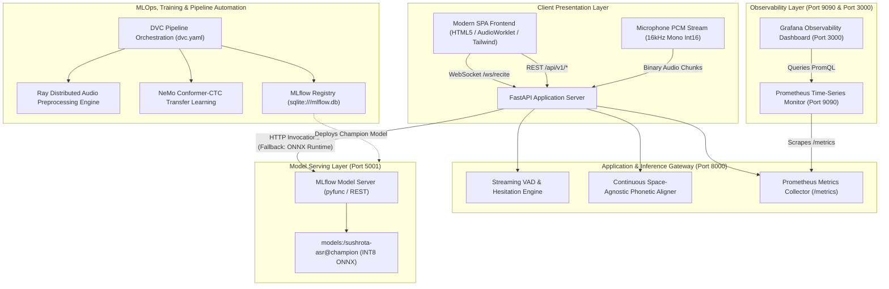
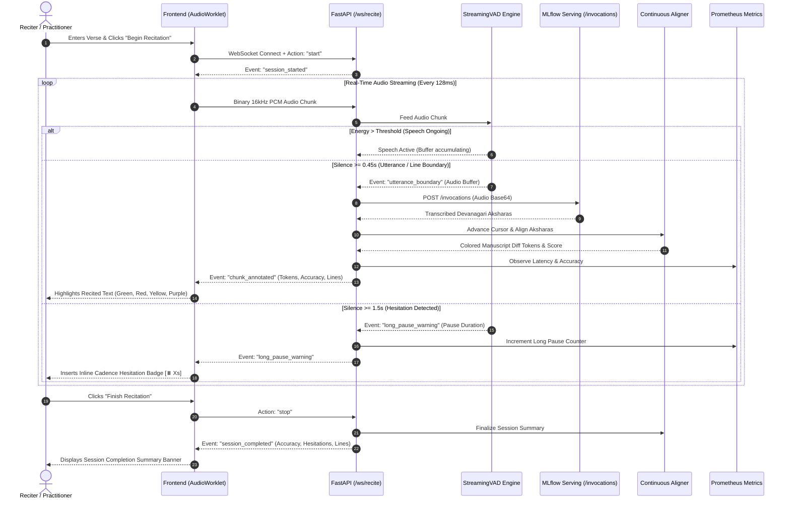

# High-Level Design Document (HLD)

**Project Name:** Project Medhā: Sanskrit & Prakrit Live Recitation Verifier  
**Course:** DA3408 - AIOps Lab  

---

## 1. Executive Summary & Problem Context

Traditional Indian practices of oral recitation and memorization of verses require precision in pronunciation, syllabic stress and pause cadence. Classically, a preceptor (*guru*) listens continuously and verifies recitation of a student in real time, alerting the speaker of his errors in pronunciation and memorization.

Prior automatic speech recognition (ASR) tools fail in this domain for three key reasons:
1. **Sandhi and Compound Word Joining:** Sanskrit and Prakrit combine words through euphonic permutation (*sandhi*). Standard ASR models trained on modern languages hallucinate spaces or break compound words arbitrarily, causing standard word-error-rate (WER) systems to fail.
2. **Computational Latency:** Autoregressive audio models (e.g., Whisper) incur several seconds of decoding latency per phrase, disrupting live recitation feedback loops.
3. **Absence of Real-Time Cadence Tracking:** Standard models do not distinguish between rhythmic line pauses (0.5s–1.0s) and hesitations (>1.5s) indicative of forgotten verses.

**Project Medhā** addresses these challenges by delivering an end-to-end, edge-deployable, real-time recitation verification system. It pairs an acoustic model (Conformer-CTC) with an akshara-level phonetic alignment engine, streaming Voice Activity Detection (VAD), and an automated MLOps pipeline.

## 2. High-Level System Architecture

The Medhā platform follows a modular, decoupled microservices architecture designed for local edge deployment, containerized isolation, and scalable distributed data processing.

A full standalone vector schematic of the pipeline and architecture is maintained at [architecture.svg](architecture.svg).

---

## 3. Core Architectural Decisions and Rationale

### 3.1 Distributed Data Cleaning: Ray Core vs. Apache Spark
* **Decision:** Adopt **Ray Core** (`@ray.remote`) for all audio preprocessing and dataset curation (`scripts/prepare_dataset.py`).
* **Rationale:**
  - *Data Modality:* Speech datasets consist of binary audio waveforms (`.wav` files) and Unicode text representations. Apache Spark is optimized for tabular and relational data; transmitting binary audio buffers across JVM-Python boundaries incurs high serialization overhead (Py4J bottlenecks).
  - *Task Parallelism:* Ray handles heterogeneous, I/O-heavy audio transformations (decoding, 16kHz resampling, RMS energy checks, dynamic silence trimming, peak normalization) across multicore CPU workers with shared memory (`plasma` store).
  - *Operational Footprint:* Ray starts in milliseconds without requiring a standalone cluster daemon or heavy JVM dependencies.
  - *Performance:* Preprocesses 78 raw clips in **5.68 seconds** (~13.7 clips/sec) across 4 workers on a standard laptop CPU.

### 3.2 Continuous Integration & Data Versioning: DVC + Git
* **Decision:** Use **DVC (Data Version Control)** to manage pipeline stage dependencies and raw data immutability (`dvc.yaml`, `params.yaml`, `data/raw.dvc`).
* **Rationale:**
  - *Data Immutability:* Storing raw speech recordings and audio clips in Git inflates repository size and degrades performance. DVC hashes the `data/raw/` directory and tracks audio version snapshots with minimal metadata footprints.
  - *Deterministic Reproducibility:* The entire lifecycle, from Ray preprocessing to NeMo training, ONNX quantization, model registry, and evaluation, is represented as a directed acyclic graph (DAG) in `dvc.yaml`.
  - *Cache Decoupling:* Heavy model artifacts (`.onnx` files) are flagged with `cache: false` in DVC to prevent storage duplication with the MLflow Model Registry.

### 3.3 Model Serving & Experiment Tracking: MLflow Model Registry
* **Decision:** Utilize **MLflow Model Registry** with the `@champion` alias convention, serving models via `mlflow models serve` (`scripts/register_mlflow_model.py`).
* **Rationale:**
  - *Elimination of Redundancy:* Rather than duplicating model artifacts between DVC cache, local folders, and tracking servers, MLflow acts as the single source of truth for trained weights, vocabularies, and runtime metadata.
  - *Deployment Abstraction:* Models are packaged as standard `mlflow.pyfunc.PythonModel` wrappers. Client applications interact with the standardized `POST /invocations` endpoint with zero coupling to whether the underlying engine is PyTorch, TensorRT, or ONNX Runtime.
  - *Resilient Fallback:* If the standalone MLflow serving container or port is unavailable during network partitions, the FastAPI backend falls back to an in-process local ONNX Runtime inference engine.

### 3.4 Acoustic Model Architecture: Conformer-CTC with INT8 Quantization
* **Decision:** Deploy a **Conformer-CTC** acoustic model quantized to **INT8 ONNX** instead of autoregressive encoder-decoder architectures (e.g., Whisper, SeamlessM4T).
* **Rationale:**
  - *Streaming Latency:* Connectionist Temporal Classification (CTC) outputs character-level probability distributions in a single forward pass without autoregressive loop overhead, achieving a Real-Time Factor (RTF) of **0.035x** to **0.039x** (~300ms per 8-second clip).
  - *Pronunciation Sensitivity:* Autoregressive models conditioned on language models frequently "hallucinate" correct words even when the speaker mispronounces syllables. CTC preserves exact acoustic phoneme predictions, making it suitable for error detection.
  - *Model Footprint:* Dynamic INT8 quantization reduces disk footprint from 441MB (NeMo archive) to **179MB** (`model_asr.onnx`), enabling smooth CPU execution with minimal thermal throttling.

### 3.5 Phonetic Alignment: Space-Agnostic Dynamic Character Mapping
* **Decision:** Custom dynamic programming space-agnostic character alignment (`src/aligner.py`) rather than standard Levenshtein word-error rate (WER).
* **Rationale:**
  - *Sanskrit Sandhi Rules:* In Devanagari recitation, word boundaries frequently merge (e.g., "णमो अरिहंताणं" recited continuously sounds identical to "णमोअरिहंताणं"). Standard WER algorithms treat joined words as deletions or substitutions, reporting false negatives.
  - *Visual Feedback:* The aligner strips whitespace during acoustic character comparison, maps transcribed aksharas to reference canonical positions, and then re-injects original manuscript spacing for color-coded visual rendering (green: correct, red: mispronounced, yellow: missing, purple: added sound).

### 3.6 Cadence & Hesitation Monitoring: Dual-Threshold Streaming VAD
* **Decision:** Implement dual-threshold streaming energy Voice Activity Detection (`src/vad_checker.py`).
* **Rationale:**
  - In classical recitation, natural pauses between verse lines (*pada* or *shloka*) range between **0.5s and 1.0s**. Pauses exceeding **1.5s** signify hesitation or forgotten verses.
  - The streaming VAD continuously evaluates frame energy:
    1. Silence between 0.5s–1.0s triggers an **Utterance Boundary**, committing the transcribed phrase to the manuscript.
    2. Silence exceeding 1.5s emits an immediate **Hesitation Warning** (`long_pause_warning`), notifying the user and logging latency metrics in Prometheus.

---

## 4. End-to-End Data Flow

The diagram below outlines the runtime lifecycle during a live recitation session:

---

## 5. Security, Scalability, and Deployment

1. **Edge-First Deployment:** The architecture functions fully offline without external cloud dependencies. All models and libraries execute in isolated Docker containers (`docker-compose.yml`).
2. **Resource Constraints:** Inference memory ceiling is capped under 1.5GB RAM, allowing concurrent execution alongside frontend and monitoring tools on resource-constrained consumer laptops.
3. **Observability:** Key operational indicators (API throughput, audio processing latency, pronunciation accuracy distributions, VAD hesitation counts) are exposed via OpenMetrics standards at `/metrics` for automated Prometheus aggregation (Port 9090) and declarative Grafana dashboard visualization (Port 3000).
