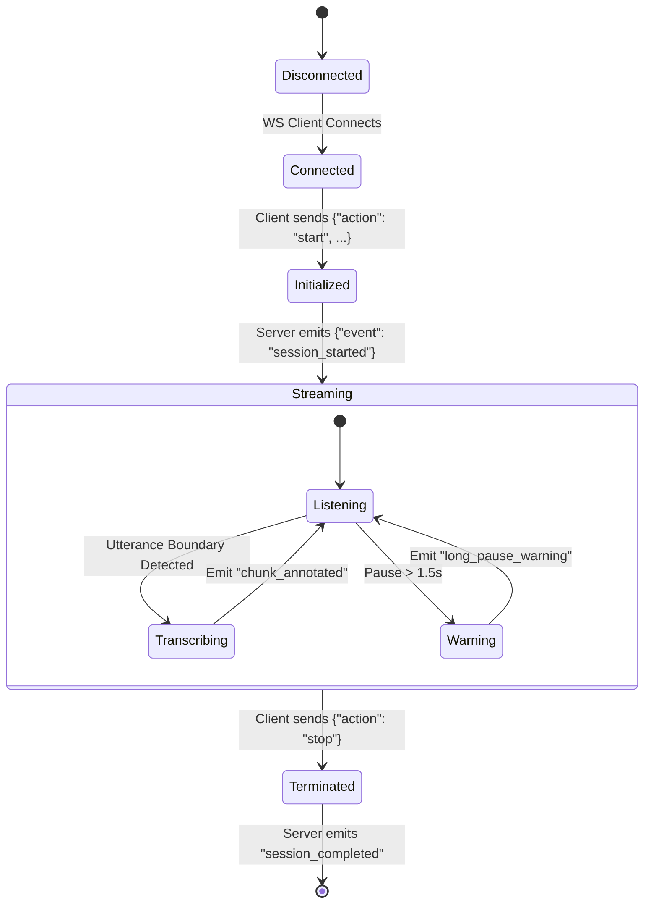

# Low-Level Design Document (LLD)

**Project Name:** Project Medhā: Sanskrit & Prakrit Live Recitation Verifier  
**Course:** DA3408 - AIOps Lab  

---

## 1. Module & Component Decomposition

The Medhā codebase is partitioned into distinct modular components, maintaining clear separation of concerns between acoustic inference, real-time audio signal processing, phonetic alignment, web serving, and distributed dataset preparation.

```
medha/
├── backend/
│   └── main.py                     # FastAPI Gateway, WebSockets & REST Endpoints
├── src/
│   ├── aligner.py                  # SushrotaVerifier, ContinuousSutraAligner, Alignment Math
│   └── vad_checker.py              # StreamingVAD & Static Audio Cadence Analyzer
├── scripts/
│   ├── download_model.py           # Download the base ASR model from Huggingface
│   ├── prepare_dataset.py          # Ray Distributed Audio & Unicode Preprocessing
│   ├── train.py                    # NeMo Fine-Tuning Script with MLflow Tracking
│   ├── convert_nemo_to_onnx.py     # ONNX INT8 Dynamic Quantization Exporter
│   └── register_mlflow_model.py    # MLflow Pyfunc Model Packaging & Champion Alias Registration
├── tests/
│   ├── evaluate.py                 # Empirical Model Validation Engine (WER, CER, RTF)
│   └── test_recitation_engine.py   # Automated Pytest Suite (27 Test Cases)
└── frontend/
    ├── index.html                  # Main page to use the recitation verifier
    └── collector.html              # Page for collecting audio data from speakers
```

---

## 2. Core Class and Engine Specifications

### 2.1 `SushrotaVerifier` (`src/aligner.py`)
Responsible for loading the quantized acoustic model, preprocessing audio waveforms into Mel-spectrograms, running acoustic inference, and generating phonetic alignment diffs.

```python
class SushrotaVerifier:
    def __init__(self, model_dir: str = "models"):
        ...
```
* **Key Attributes:**
  - `asr_session`: `onnxruntime.InferenceSession` (quantized INT8 acoustic model, used for local fallback).
  - `prep_session`: `onnxruntime.InferenceSession` (audio preprocessor converting 16kHz PCM to log-mel spectrogram).
  - `vocab`: Dictionary mapping integer CTC token indices to Devanagari characters.
  - `mlflow_serving_url`: Network endpoint for standalone MLflow model serving (configured via `MLFLOW_SERVING_URL`).
* **Key Methods:**
  - `transcribe(audio_path_or_array)` $\to$ `str`: Executes audio transcription. First attempts an HTTP request to `mlflow_serving_url`. If unreachable, executes local in-process ONNX Runtime inference.
  - `verify_recitation(transcribed_text, reference_text)` $\to$ `Dict`: Computes token-level discrepancies, match accuracy percentage, and aligned diff tokens.

### 2.2 `ContinuousSutraAligner` (`src/aligner.py`)
Tracks continuous recitation over multi-line sacred manuscripts without requiring manual line advancing or hard line splitting.

* **State Tracking:**
  - `cursor_orig_idx`: Index of the current position in the original raw manuscript.
  - `cursor_clean_idx`: Index within the whitespace-stripped phonetic representation.
  - `line_phonetic_ends`: Cumulative phonetic character counts marking the end of each manuscript line.
  - `annotated_chunks`: Array of verified utterance events.
* **Key Methods:**
  - `compute_lines_completed()` $\to$ `int`: Computes the number of completed verse lines based on phonetic coverage.
  - `process_utterance(audio_array, pause_duration)` $\to$ `Dict`: Takes an audio buffer from the VAD, transcribes it, advances the cursor dynamically using substring matching and Levenshtein alignment, inserts an inline `pause_badge` token if `pause_duration > max_pause_s`, and returns colored token annotations.
  - `get_session_summary()` $\to$ `Dict`: Aggregates overall recitation accuracy, total recited characters, lines completed, and total hesitation pauses.

### 2.3 `StreamingVAD` (`src/vad_checker.py`)
Stateful real-time Voice Activity Detector operating on sequential 16kHz mono audio frames.

* **Configuration Parameters:**
  - `sample_rate`: Audio sampling frequency (default: `16000`).
  - `energy_threshold`: Root-Mean-Square (RMS) amplitude threshold for speech detection (default: `0.012`).
  - `min_speech_duration_s`: Minimum duration required to qualify an energy burst as speech (default: `0.25s`). Shorter transients are discarded.
  - `line_pause_s`: Cadence silence duration triggering an utterance boundary (default: `0.45s`).
  - `max_allowed_pause_s`: Silence duration qualifying as a recitation hesitation (default: `1.5s`).
* **Key Methods:**
  - `feed_chunk(chunk: np.ndarray)` $\to$ `List[Dict]`: Processes a streaming chunk and returns state transition events (`speech_start`, `line_boundary`, `long_pause_warning`).
  - `flush()` $\to$ `Optional[np.ndarray]`: Flushes any remaining active speech in the buffer upon session stop.

### 2.4 `SushrotaASRPyfunc` (`scripts/register_mlflow_model.py`)
Custom `mlflow.pyfunc.PythonModel` wrapper implementing the standardized MLflow serving interface.

* **Inference Pipeline:**
  - Accepts a Pandas DataFrame containing either an `audio_path` string or base64-encoded audio bytes (`audio_base64`).
  - Normalizes audio to 16kHz float32.
  - Runs ONNX preprocessor to extract mel spectrogram tensor `[1, 80, T]`.
  - Executes INT8 Conformer-CTC acoustic model to extract log-probability tensor `[1, T, 257]`.
  - Performs greedy CTC decoding with index `0` as the CTC blank token and removes SentencePiece word boundaries (` `).

---

## 3. API Endpoint Definitions & I/O Specifications

### 3.1 Health Check
* **Endpoint:** `GET /health`
* **Description:** Verifies service availability, loaded vocabulary size, and MLflow serving health status.
* **Response (200 OK):**
```json
{
  "status": "healthy",
  "service": "Project Medhā Recitation Engine",
  "model_dir": "models",
  "vocab_size": 257,
  "mlflow_serving": {
    "url": "http://host.docker.internal:5001/invocations",
    "status": "active"
  }
}
```

---

### 3.2 Metrics Endpoint (Prometheus Exporter)
* **Endpoint:** `GET /metrics`
* **Description:** OpenMetrics time-series endpoint scraped by Prometheus.
* **Key Metrics Exported:**
  - `api_requests_total{endpoint=...}`: Cumulative HTTP requests by endpoint (pre-initialized, tracked via middleware).
  - `inference_duration_seconds`: Histogram of acoustic model inference latency.
  - `recitation_accuracy_percentage`: Distribution of recitation pronunciation accuracy percentage.
  - `cadence_hesitations_total`: Counter tracking recitation pauses exceeding 1.5s threshold.
  - `live_recitation_sessions_total`: Total live WebSocket recitation sessions started.
  - `live_lines_verified_total`: Total individual sutra lines verified live.
  - `active_websocket_connections`: Gauge tracking concurrent active live recitation streams.

---

### 3.3 Audio File Verification (Batch Analysis)
* **Endpoint:** `POST /api/v1/analyze`
* **Content-Type:** `multipart/form-data`
* **Request Parameters:**
  - `file`: Binary audio file (`.wav`, `.mp3`, `.m4a`, `.ogg`, `.flac`).
  - `reference_text`: Unicode Devanagari reference manuscript text.
* **Response (200 OK):**
```json
{
  "status": "success",
  "reference_text": "खामेमि सव्व जीवे सव्वे जीवा खमंतु मे",
  "transcription": "खामेमि सव्व जीवे सव्वे जीवा खमंतु मे",
  "similarity_score": 100.0,
  "discrepancies": [],
  "diff_tokens": [
    {"type": "correct", "text": "खामेमि"},
    {"type": "preserve", "text": " "},
    {"type": "correct", "text": "सव्व"}
  ],
  "long_pauses": [
    {
      "after_second": 3.2,
      "pause_duration_seconds": 1.85
    }
  ],
  "latency_seconds": 0.34
}
```
* **Error Responses:**
  - `400 Bad Request`: Reference text contains no Devanagari characters.
  - `422 Unprocessable Entity`: Missing `reference_text` or `file` parameter.
  - `500 Internal Server Error`: Audio decoder failure or unhandled runtime exception.

---

### 3.4 Live WebSocket Recitation Stream
* **Endpoint:** `WS /ws/recite`
* **Protocol Flow:**



#### Message Schemas:

1. **Client Start Handshake:**
```json
{
  "action": "start",
  "reference_text": "णमो अरिहंताणं\nणमो सिद्धाणं\nणमो आयरियाणं",
  "energy_threshold": 0.012,
  "max_pause_s": 1.5,
  "line_pause_s": 0.45
}
```

2. **Server Handshake Acknowledgment:**
```json
{
  "event": "session_started",
  "total_phonetic_chars": 33,
  "total_lines": 3
}
```

3. **Client Audio Stream Chunk:**
   - Format: Raw binary array of 16-bit signed PCM audio samples (16,000 samples/sec mono, Little-Endian).

4. **Server Live Event: Chunk Annotated:**
```json
{
  "event": "chunk_annotated",
  "transcription": "णमो अरिहंताणं",
  "tokens": [
    {"type": "correct", "text": "णमो"},
    {"type": "preserve", "text": " "},
    {"type": "correct", "text": "अरिहंताणं"}
  ],
  "orig_text_segment": "णमो अरिहंताणं",
  "pause_duration": 0.82,
  "is_long_pause": false,
  "overall_accuracy": 100.0,
  "accuracy_percentage": 100.0,
  "progress_percentage": 33.3,
  "line_index": 1,
  "lines_completed": 1,
  "total_lines": 3,
  "total_long_pauses": 0,
  "total_hesitations": 0,
  "hesitation_count": 0,
  "is_completed": false
}
```

5. **Server Live Event: Hesitation Warning:**
```json
{
  "event": "long_pause_warning",
  "pause_duration": 1.65
}
```

6. **Client Stop Handshake:**
```json
{
  "action": "stop"
}
```

7. **Server Session Completed Summary:**
```json
{
  "event": "session_completed",
  "summary": {
    "overall_accuracy": 100.0,
    "accuracy_percentage": 100.0,
    "total_phonetic_chars": 33,
    "processed_chars": 33,
    "correct_chars": 33,
    "total_chunks": 3,
    "lines_completed": 3,
    "total_lines": 3,
    "total_long_pauses": 0,
    "total_hesitations": 0,
    "hesitation_count": 0,
    "average_pause_seconds": 0.78,
    "completed_all": true
  }
}
```

---

### 3.5 Collaborative Speech Collector Endpoints

#### `GET /api/v1/collector/prompts`
* **Response:**
```json
{
  "prompts": [
    {"id": 1, "text": "णमो अरिहंताणं"},
    {"id": 2, "text": "णमो सिद्धाणं"}
  ]
}
```

#### `POST /api/v1/collector/prompts`
* **Request:**
```json
{
  "raw_text": "णमो अरिहंताणं\nणमो सिद्धाणं\nणमो आयरियाणं"
}
```
* **Response:**
```json
{
  "status": "success",
  "total_prompts": 3
}
```

#### `POST /api/v1/collector/upload`
* **Request (Form Data):**
  - `file`: Recorded binary audio file.
  - `prompt_id`: Integer identifier.
  - `text`: Prompt manuscript text.
  - `speaker`: Contributor identifier or pseudonym.
* **Processing:**
  - Normalizes audio to 16kHz Mono 16-bit WAV via PyAV/FFmpeg/Soundfile.
  - Saves file to `data/raw/clip_{timestamp}_{speaker}_p{prompt_id}.wav`.
  - Appends record to `data/raw/metadata.csv`.
* **Response:**
```json
{
  "status": "success",
  "filename": "clip_1794387514520_Sweta_p1.wav",
  "duration": 2.85,
  "prompt_id": 1,
  "total_clips": 79,
  "total_duration_minutes": 10.61
}
```

#### `GET /api/v1/collector/stats`
* **Response:**
```json
{
  "total_clips": 78,
  "total_minutes": 10.56,
  "speakers": {
    "Sweta": 24,
    "Pakshal": 22,
    "Aditi": 18,
    "Rahul": 14
  },
  "recent_recordings": [
    {
      "filename": "clip_1794387514520_Sweta_p5.wav",
      "text": "णमो लोए सव्वसाहूणं",
      "speaker": "Sweta",
      "duration_seconds": "3.12",
      "timestamp": "2026-11-14 16:30:22"
    }
  ]
}
```

---

### 3.6 MLflow Serving Invocations Endpoint
* **Endpoint:** `POST http://localhost:5001/invocations`
* **Request Schema:**
```json
{
  "dataframe_records": [
    {
      "audio_path": "data/processed_audio/clip_sample.wav",
      "audio_base64": null
    }
  ]
}
```
* **Response Schema:**
```json
{
  "predictions": [
    {
      "transcription": "णमो अरिहंताणं",
      "tokens_count": 13,
      "status": "success"
    }
  ]
}
```
